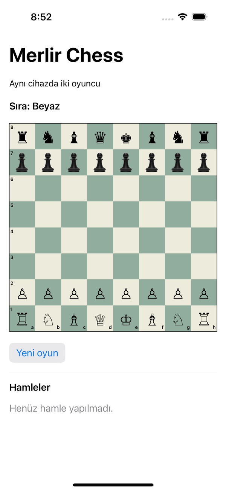
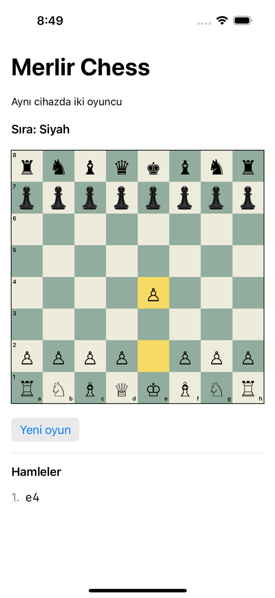
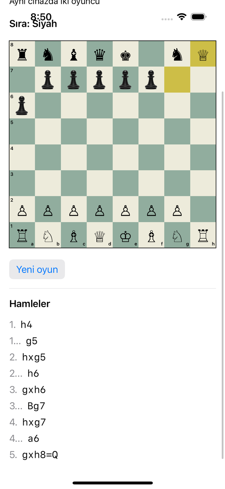
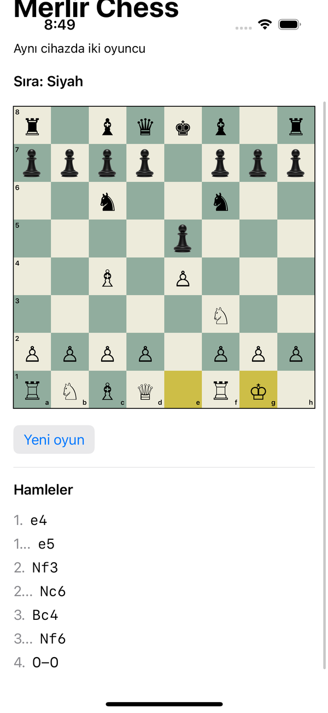
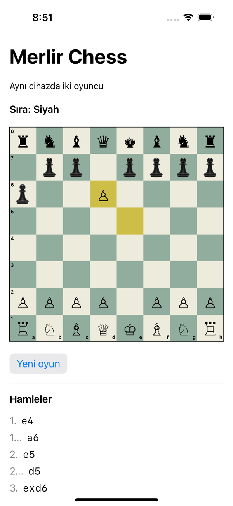
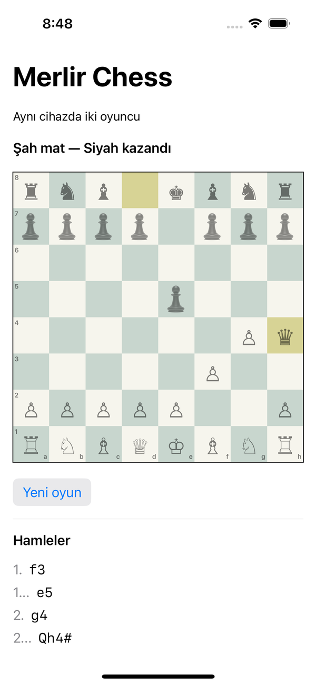
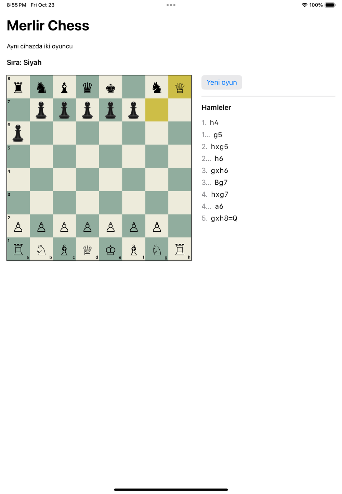
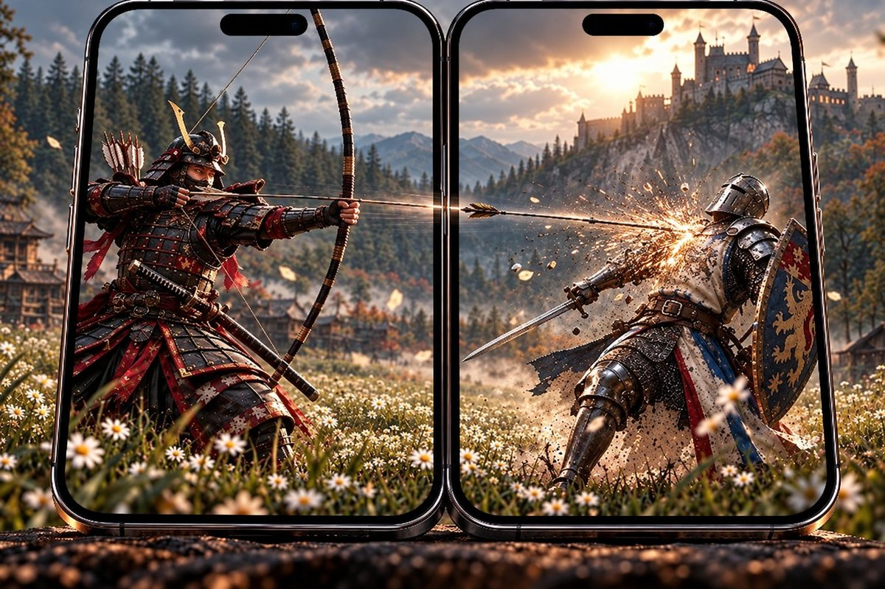
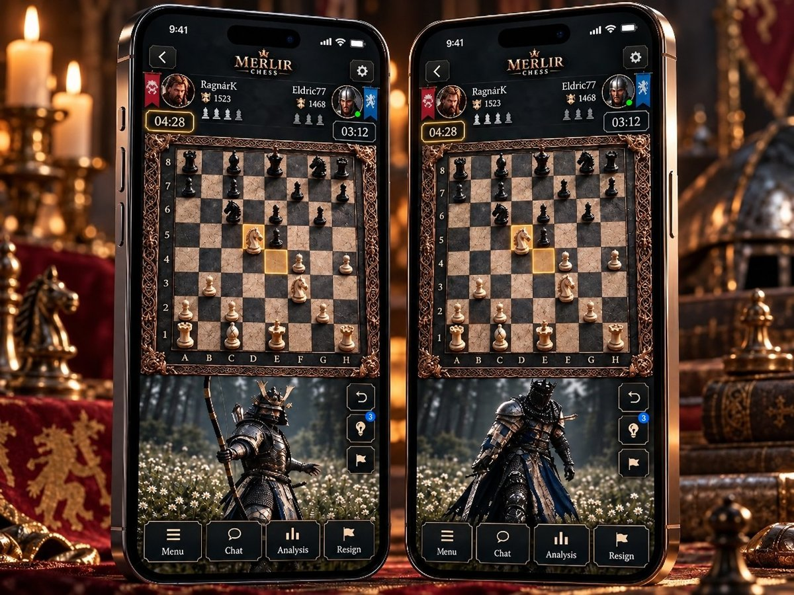
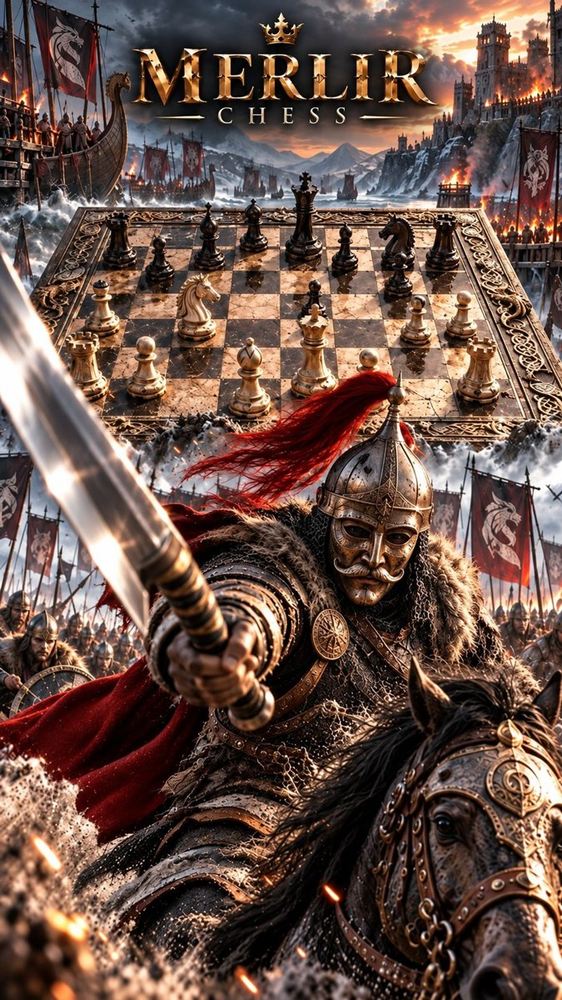

# MERLIR CHESS — Volunteer Interest List

**Cinematic Chess — Every Game Is a Movie.**

> **This is not the MERLIR CHESS source code repository.** This repository describes the project and hosts the volunteer interest list. The game's source code is private and is not open source. Developers who want to write code can get **individual, task-specific access** — see [How to get involved](#how-to-get-involved).

## Who is behind this

MERLIR CHESS is an **independent game development project** run by one person, **Ömer Bilir** ([@omerbiliroffice-jpg](https://github.com/omerbiliroffice-jpg)).

- MERLIR STUDIO and MERLIR GAMES are **project brand names only**. They are not registered companies or legal entities, and they are not registered trademarks.
- There is no company, no paid staff, and no sales yet.
- The game is being developed with the **intention of a future commercial release**.

## The vision

MERLIR CHESS is a planned chess game for Apple platforms (iPhone, iPad and Mac). It keeps the rules of classical chess exactly as they are — and turns significant moves into short, dramatic, sound-designed battle scenes.

We are not simply adding videos to a chess game. We are designing a cinematic chess experience where the meaning of each significant move can trigger a corresponding dramatic scene, presented through a native Apple video system inspired by the visual behavior of live-stream animated gift effects.

## Screenshots — the real app today

These are **real screenshots of the current app**, captured automatically by our iOS Simulator UI tests on GitHub's macOS CI (iPhone 16 and iPad 10th generation, iOS 18.5). The engine, board and move list are working; the cinematic system is not built yet.

| Start | Legal move | Promotion | Castling |
|---|---|---|---|
|  |  |  |  |

| En passant | Checkmate | iPad |
|---|---|---|
|  |  |  |

## Concept art — AI-generated, not the final game

> **These images are AI-generated concept art.** They only illustrate the intended mood and direction. They are **not** screenshots, not final artwork, and do not show implemented features. Interface elements in them (player names, ratings, chat, analysis buttons, device frames) are illustrative only and are not planned features. The final game may look completely different. These images are not offered for reuse.

| Cinematic scene concept | Game screen concept | Poster concept |
|---|---|---|
|  |  |  |

## Planned Gameplay & Cinematic Presentation System

> Everything in this section is **planned**. None of it is implemented yet.

**What makes it different.** Most chess apps animate pieces. MERLIR CHESS plans to understand what a move means — an attack, a defense, a sacrifice, a check, a comeback, a promotion, a checkmate — and respond with a short scene that tells that story. Cinematics never change the rules or the game state.

**Visual reference.** On live-stream platforms, an animated gift effect appears briefly on top of the stream while the stream keeps going (TikTok LIVE is a well-known example). MERLIR CHESS takes inspiration from that presentation style only: instead of gifts, chess moves trigger short scenes. The game does not use, depend on, or integrate with TikTok or any of its technology, and has no affiliation with TikTok. TikTok is a trademark of its respective owner.

**How a move becomes a scene (example).**

1. The player's knight captures a bishop.
2. The chess engine validates the move.
3. An event analysis step decides what the move means (here: an attack).
4. A cinematic decision system picks a matching short scene.
5. The scene plays in the cinematic area at the bottom of the game screen, with synchronized sound.
6. When it ends, the area returns to its normal state.

**Screen layout.** The **interactive chessboard** stays the main interface. A **cinematic presentation area** at the bottom of the screen plays scenes as part of the game screen — no separate video page. It may briefly overlap parts of the interface, but important game information stays accessible, and players can skip or turn off cinematics.

**Planned architecture.**

```
ChessCore / MerlirEngine
  → Move Validation
  → Drama & Event Analysis
  → Cinematic Intent
  → Presentation Controller
  → Native Apple Video Playback (AVFoundation)
```

**Planned video targets (development goals, not final decisions).** HEVC (H.265) in MP4 or MOV · 1080 × 1920 source (scaled or cropped to the cinematic area) · 3–5 s standard scenes, 5–15 s key scenes · synchronized sound · AVFoundation / AVPlayer with preloading · HEVC with Alpha for some overlay effects, where useful.

## Where we are today

- **Implemented and tested:** chess engine (legal moves, check, checkmate, stalemate, castling, en passant, promotion, FEN validation, SAN move list) with automated tests; SwiftUI board screen connected to the engine; iPhone / iPad app target that builds on macOS CI.
- **Tested on CI:** iOS Simulator UI tests on iPhone and iPad (legal and illegal moves, new game, promotion, both castlings, en passant, checkmate).
- **In progress:** accessibility audit, VoiceOver and on-device testing.
- **Not started:** cinematic system, video content, bots, save/resume, Mac version.

## Independent contributor model

> We welcome independent, optional and unpaid code contributions from developers who voluntarily wish to support MERLIR CHESS. Contributors are free to choose whether, when and how to contribute, without mandatory working hours or ongoing work obligations. Any accepted contributions will be governed by separately agreed written intellectual property and commercial licensing terms. This model does not override applicable employment laws where the actual relationship legally constitutes employment.

Contributors are not employees. Possible contributions will be shared as optional opportunities, never as work orders, and can be freely accepted or declined. Not every submitted contribution will be accepted.

## How contributing would work — two separate stages

**Stage A — Volunteer interest (open now).** You tell us which areas interest you through the public interest form. That's all.
- No contract, no task, no code accepted, no repository access.
- No obligation for you to ever contribute, and no obligation for us to offer you anything.
- Signing up does **not** mean agreeing to any contributor agreement.

**Stage B — Independent code contribution (later, only if both sides separately decide).** Before any code is written, you would receive in writing: the proposed contribution's scope, confirmation that it is unpaid, the intellectual property terms (an individual contributor license agreement), access and security limits, and how contributions are reviewed, accepted or rejected. No code is included in the project before the written license is signed. You can say no at any point.

## Honest terms

- Contributions would be **unpaid**. No salary, payment, revenue share, equity, or future job offer is promised or implied.
- The game may in the future be **sold as a paid game, licensed, or sold as a project**.
- No working hours, shifts, mandatory meetings, quotas, attendance or mandatory deadlines. You choose whether, when and how to contribute, and you can stop at any time without giving a reason.
- We never ask for any fee or payment from volunteers.
- We do not promise visibility or career opportunities. Being named in an acknowledgements section is optional and only for accepted contributions.
- Stage B is open only to people **18 or older**.
- Your intellectual property is not transferred automatically to anyone. Rights in accepted contributions are set out in a separate written license.
- We do not accept artwork or visual asset contributions.
- These terms do not override applicable employment laws.

## Areas of interest

Swift / SwiftUI · AVFoundation / AVPlayer · iOS video playback optimization · HEVC video / alpha compositing · SpriteKit / SceneKit / RealityKit · chess engine architecture · chess AI / bot development · event-driven animation systems · iPhone / iPad / Mac UI development · Apple platform testing · performance and memory optimization

These are potential areas only. No tasks are being offered at this time.

## How to get involved

**1. Join the interest list (open).** [Open the volunteer interest form](https://github.com/omerbiliroffice-jpg/merlir-chess-volunteers/issues/new?template=volunteer.yml). Please read [PRIVACY.md](PRIVACY.md) first — **the issue is public**, so do not include your real name, email, phone or other personal details.

**2. Contribution opportunity (only if both sides want).** If an area fits, we reply on your issue to describe an optional, unpaid contribution opportunity. You can decline or simply not answer.

**3. Written terms before any code.** Before you write code, you receive and sign the written contributor terms and the individual contributor license agreement (Stage B). Nothing is signed or agreed through the issue itself.

**4. Individual, task-specific code access.** After signing, you get access to a **separate private repository** that contains only the code needed for that task. The main source repository stays private and is not shared.

- To simply follow the project, you can **watch or star** this repository. Stars and watches are not applications and create no relationship or obligation.
- Please do not send applications by email; use the form. Email is only for privacy requests: omerbilir.office@gmail.com.

## Rights in this repository

This repository is **not** licensed as open source. Its text and materials are © Ömer Bilir, all rights reserved, except for the viewing and forking that [GitHub's Terms of Service](https://docs.github.com/en/site-policy/github-terms/github-terms-of-service) allow for public repositories.

---

## Türkçe özet

**Bu depo MERLIR CHESS'in kaynak kod deposu değildir.** Projeyi tanıtır ve gönüllü ilgi listesini barındırır. Oyunun kaynak kodu özeldir ve açık kaynak değildir.

MERLIR CHESS, **Ömer Bilir** tarafından yürütülen bağımsız bir oyun geliştirme projesidir. MERLIR STUDIO ve MERLIR GAMES sadece proje marka adlarıdır; kayıtlı şirket, tüzel kişi veya tescilli marka değildir. Şu an şirket, ücretli çalışan veya satış yoktur; oyun ileride ticari olarak yayımlanmak üzere geliştirilmektedir.

Oyun, klasik satranç kurallarını değiştirmeden önemli hamleleri ekranın alt bölümünde oynatılan kısa, sesli sinematik savaş sahnelerine dönüştürmeyi hedefler. Sunum tarzı canlı yayınlardaki animasyonlu hediye efektlerinden ilham alır; TikTok ile hiçbir bağlantı veya teknoloji ilişkisi yoktur. Sinematik sistem henüz planlama aşamasındadır.

Katkı iki ayrı aşamadan oluşur. **A Aşaması (açık):** Herkese açık ilgi formuyla sadece ilgi bildirilir; sözleşme, görev, kod kabulü veya depo erişimi olmayacak, kimse için yükümlülük doğmayacak ve bir katkı sözleşmesi kabul edilmiş sayılmayacak. **B Aşaması (ileride, iki taraf da isterse):** Kod yazılmadan önce görev kapsamı, ücretsizlik, fikrî mülkiyet koşulları, erişim sınırları ve kabul yöntemi yazılı olarak sunulur.

**Bağımsız katkı modeli:** Katkıcılar çalışan değildir; katkı sunup sunmayacaklarına, ne zaman ve nasıl sunacaklarına kendileri karar verir. Görev önerileri iş emri değil, isteğe bağlı katkı fırsatıdır; özgürce kabul veya reddedilebilir. Sunulan her katkının kabul edilmesi zorunlu değildir. Katkı ücretsizdir; maaş, ödeme, gelir payı, hisse veya iş teklifi sözü yoktur. Çalışma saati, vardiya, zorunlu toplantı, kota veya zorunlu teslim tarihi yoktur; katkıcı istediği zaman gerekçe göstermeden bırakabilir. Fikrî mülkiyet hakları kendiliğinden kimseye geçmez; kabul edilen katkılar ayrı yazılı lisansla düzenlenir. Bu model, ilişkinin fiilen iş ilişkisi olduğu durumlarda uygulanacak zorunlu iş hukuku kurallarını ortadan kaldırmaz. B Aşaması 18 yaş ve üzeri kişilere açıktır. Görsel katkı kabul edilmez. **İlgi listesi açıktır:** [ilgi formunu açın](https://github.com/omerbiliroffice-jpg/merlir-chess-volunteers/issues/new?template=volunteer.yml). Form herkese açık bir issue oluşturur; gerçek adınızı, e-postanızı veya telefonunuzu yazmayın ve önce [PRIVACY.md](PRIVACY.md) dosyasını okuyun. Uygun bir alan olursa issue üzerinden isteğe bağlı bir katkı fırsatı anlatılır. Kod yazmadan önce yazılı katkı koşulları ve lisans sözleşmesi imzalanır; ardından sadece o göreve ait kodu içeren **ayrı bir özel depoya kişiye özel erişim** verilir. Ana kaynak kod deposu özel kalır.

**Görseller:** "Screenshots" bölümündeki görüntüler uygulamanın bugünkü gerçek ekranlarıdır (GitHub macOS CI simülatör testleri). "Concept art" bölümündeki görseller **yapay zekâ ile üretilmiş konsept görsellerdir**; nihai oyunu veya mevcut özellikleri göstermez ve yeniden kullanım için sunulmaz.
